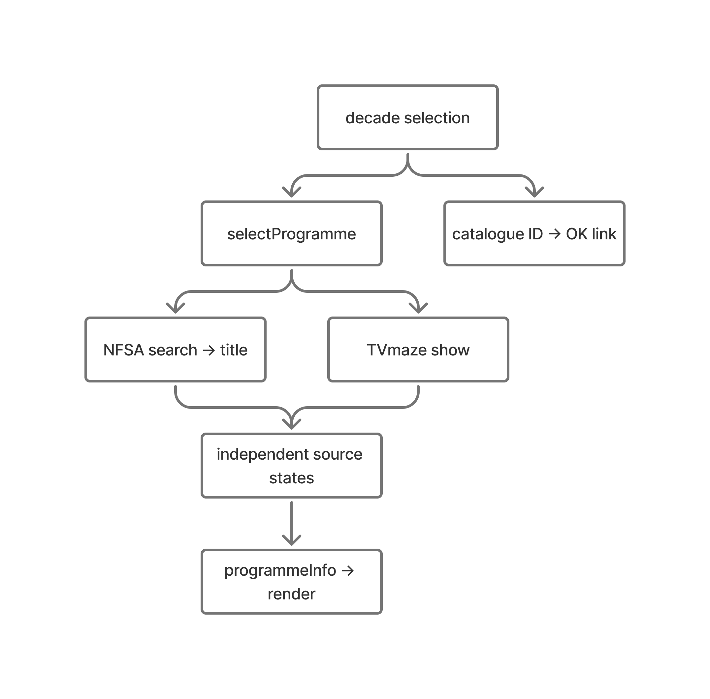

# Assessment 3: Web App Technical Evaluation

## Introduction

ON AIR is my single-page application for exploring Australian television through eight decade-based selections. I developed the concept around a visual timeline and remote-style controls, with an OK button connecting each selection to the National Film and Sound Archive of Australia (NFSA). The application uses NFSA search and title data for catalogue information, descriptions and available previews. TVmaze supplements missing series information and artwork.

It is composed with HTML, CSS and JavaScript. The HTML supplies the page structure, CSS establishes the visual presentation, and JavaScript manages navigation, requests and display updates. A local programme array connects each decade to its catalogue identifiers. This walkthrough evaluates three consequential sections: archive identification, source selection and asynchronous state management. I distinguish my requirements and design decisions from generated implementation choices, assess alternatives retrospectively, and identify limitations that remain in the evaluated version.

**Figure 1. Simplified data flow for a selected decade**



*The two sources update independently. OK uses the selected catalogue ID even when an API request fails.*

## 1. Matching archive records and constructing catalogue links

**Code location: `script.js`, `loadProgramme()` (excerpt).**

```javascript
    const params = new URLSearchParams({ query: String(id), page: '1', limit: '25' });
    const data = await requestJSON('/search?' + params, signal);
    results = validateSearch(data);
    if (results.length) searchCache.set(id, results);
  }
  const preview = findRecord(results, id);
  if (!preview) return null;
```

I required each programme to have an NFSA connection, making record identity more important than simply displaying a plausible search result. `loadProgramme()` searches by the locally stored `recordId`, using the NFSA endpoints supplied in the unit materials. `validateSearch()` checks that the response contains a results array. The `findRecord(results, id)` call then locates the exact identifier. Its comparison converts both values to strings, accommodating an API ID represented as text rather than a number.

The `if (!preview) return null` decision prevents unrelated results from entering the display. After the excerpt, a matching result leads to `/title/{id}`, where the returned identifier and title are validated. Both responses are useful because a search result may supply an image preview absent from the detail record. This structure prioritises a consistent archive identity, although requiring search success before fetching details introduces an additional dependency.

The same identifier reaches `archiveURL()`, which constructs the public catalogue search opened by OK. I identified the no-results problem and requested catalogue-based links. After diagnosing the incorrect search field, `mdd_version_id1` was implemented. This correction demonstrates why apparently valid syntax is insufficient: a URL can load successfully while searching the wrong category of information.

The generated cache logic remains imperfect. The line `if (results.length) searchCache.set(id, results)` saves a nonempty response before checking whether it contains the required record. An AI-assisted controlled check supplied an unrelated ID and called the loader twice. Only one search request occurred, demonstrating that retry reused the unsuitable list. I would move caching after successful matching and verify recovery with an incorrect first response followed by a correct second response.

A retrospective alternative is requesting the title directly, then searching only for a missing preview. That could reduce requests and remove the search dependency. I would compare available images across all eight entries before changing the sequence. I would also inspect the destination of every OK link, since successful API matching cannot establish that the public search page displays the corresponding record.

## 2. Combining sources without confusing programmes and archive objects

**Code location: `script.js`, `programmeInfo()` (excerpt).**

```javascript
  const nfsaOverview = value(record?.parentTitle?.seriesSummary) || value(record?.parentTitle?.seasonSummary);
  const overview = nfsaOverview || value(show?.summary) || value(record?.summary);
  const summarySource = nfsaOverview ? 'NFSA programme overview' : value(show?.summary) ? 'TVmaze programme overview' : value(record?.summary) ? 'NFSA archive-item description' : '';
```

I used an additional API because some archive entries lacked suitable programme details or imagery. However, I retained NFSA as the destination of OK. This distinction separates the programme being introduced from the particular object held by the archive. The TVmaze integration and the field-selection rules in the `programmeInfo()` function determines how individual fields would be selected.

The excerpt implements a hierarchy for descriptions. `nfsaOverview` first checks the parent record for a series or season summary. The `overview` expression then prefers that value, followed by the TVmaze summary and finally the NFSA item description. The `summarySource` expression generates the corresponding label. Optional chaining, represented by `?.`, allows missing parent information to be encountered without immediately causing a property-access error. The `value()` helper treats non-string or blank values as unavailable.

This ordering matters because a poster description or episode synopsis does not necessarily introduce a series. Selecting any available paragraph would be shorter to implement, but would obscure what the information describes. I would retain the explicit source labels and the separate archive-item disclosure. A further improvement would distinguish season summaries from series summaries, since the current label groups both as a programme overview.

TVmaze documents direct show lookup and warns that identical titles can produce ambiguous single-search results (TVmaze, n.d.). The application therefore stores a separate TVmaze ID for each matched series. The original *Heartbreak High* uses ID `3992`, avoiding reliance on its shared title with the remake. The 1956 opening broadcast has no curated TVmaze match, so its supplementary request is deliberately skipped. Missing information is preferable to an unrelated substitution.

I assess the premiere-date rule less favourably. It accepts a full TVmaze date when its format and year agree with the curated entry. An AI-assisted check confirmed that a conflicting 1995 date falls back to the locally stored 1994 year for *Heartbreak High*. That safeguard works as written, but year agreement cannot establish an Australian release date. I would retain only the curated year unless the source also establishes release territory. This illustrates the difference between validating a value’s format and validating its historical meaning.

## 3. Managing asynchronous requests and independent source states

**Code location: `script.js`, `selectProgramme()`, nested `loadSource()` function (excerpt).**

```javascript
  async function loadSource(source, loader) {
    try {
      const data = await loader(programmes[index], activeController.signal);
      if (currentRequest !== requestNumber) return;
      if (source === 'nfsa') { state.record = data?.item || null; state.image = data?.image || null; }
      else state.show = data;
      state[source + 'Status'] = data ? 'success' : 'empty';
```

I wanted direct movement between decades without full-page reloads. This creates a technical risk: requests can finish in a different order from the selections that initiated them. A slow response for *Heartbreak High* must not replace the details of *Bluey* after the visitor has moved forward. 

At the beginning of `selectProgramme()`, the previous controller is aborted and a new request number is assigned. `AbortController` can cancel fetch operations through an associated signal (MDN contributors, 2025). The excerpt supplies that signal to the loader. After `await` returns, `if (currentRequest !== requestNumber) return` prevents an outdated selection from updating state. Cancellation reduces unnecessary work, while the number comparison explicitly determines whether a response still belongs on screen. Equivalent checks also protect the error and cleanup paths.

The assignment `state[source + 'Status'] = data ? 'success' : 'empty'` distinguishes a valid record from an absent match. Separate NFSA and TVmaze statuses also allow one source to succeed while the other fails. Each loader renders its result independently. Later, `Promise.allSettled()` joins both operations before the shared timeout is cleared. It does not itself produce the partial display. This distinction is important when explaining why useful information remains available during a service failure.

A simpler alternative would wait for both sources and display one combined result. That would reduce intermediate updates but delay successful information behind the slower service. A framework could organise larger applications, although it would not remove the need for these decisions. For eight fixed selections, I consider the existing shared state proportionate, provided its transitions remain understandable.

The rendering strategy nevertheless deserves refinement. Every update calls `renderImage()`, which removes the current image element and restarts image selection. I would preserve the element when its candidates are unchanged. To evaluate the benefit, I would delay one API response and observe whether the later text update unnecessarily replaces an already visible image. Source inspection demonstrates element replacement, but it does not prove repeated network downloads or visible flicker.

## Weaknesses and technical debt

The evaluated version retains several limitations. The cache mismatch is the most immediate defect because it prevents an advertised recovery action from making a fresh request. It should be addressed before claiming reliable recovery across all empty-result conditions.

Curated programme IDs and years require maintenance. This is an accepted consequence of the one-example-per-decade concept, rather than a comprehensive collection browser. Automated discovery would broaden coverage but introduce new matching and editorial decisions beyond that scope. The premiere-date assumption requires a narrower correction: remove unsupported precision instead of introducing another unverified source.

External catalogue pages and image hosts also remain outside the application’s control. A correctly constructed link is not evidence that its destination currently contains the expected result. Manual destination checks should accompany submission. Similarly, image element replacement warrants observation before performance claims are made.

These limitations call for targeted evaluation: retry after a mismatched response, rapid navigation with delayed requests, and one blocked API while the other remains available. Proposed browser demonstrations should not be presented as completed tests until I have performed and recorded their actual outcomes.

## Conclusion

If I continued development, I would first correct cache placement and verify that retry recovers from an initially mismatched response. I would then restrict premiere information to supported years and preserve images across unrelated text updates. I would retain catalogue-based identity, explicit source labels and independent source states because they address the central risks of this application. The evaluation has clarified that successful data retrieval alone does not establish accuracy or reliability. My next iteration would therefore prioritise small, observable improvements to the existing architecture, with each change linked to a specific failure condition and a repeatable acceptance check.

## References

Markdown Guide. (n.d.). *Basic syntax*. https://www.markdownguide.org/basic-syntax/

MDN contributors. (2025, September 17). *AbortController*. MDN Web Docs. https://developer.mozilla.org/en-US/docs/Web/API/AbortController

TVmaze. (n.d.). *TV API*. https://www.tvmaze.com/api

*I have used the following Generative Artificial Intelligence (GenAI) tools/services in the preparation of this
assessment:*
- GenAI service name and version: ChatGPT
- Link to the GenAI service: https://chatgpt.com/
- Ways this GenAI service was used: assisting in structuring my evaluation and correcting spelling/grammatical errors
*I confirm that I have not used the Generative Artificial Intelligence service in development of this work for assessment other than what I have declared and acknowledged above and I have cited and referenced any GenAI content in my assessment submission, applying the relevant referencing style. I understand that providing false or misleading information in this declaration and acknowledgement may constitute a breach of the University of Canberra (Student Conduct) Rules 2023.*

